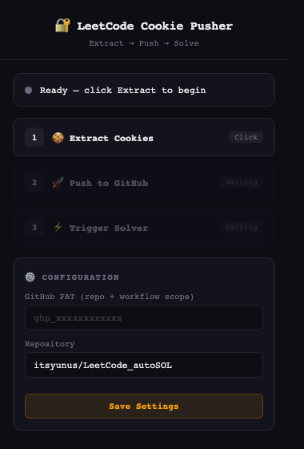

# LeetCode Cookie Pusher

A Chrome Manifest V3 extension that verifies an active LeetCode session, encrypts session cookies using the target GitHub repository public key via Libsodium sealed-box cryptography, updates GitHub Actions repository secrets, and dispatches companion solver workflows.

## Architecture and Flow

1. Session Extraction: Queries Chrome cookie store for `LEETCODE_SESSION` and `csrftoken` under `.leetcode.com`.
2. Cryptographic Sealed Box: Retrieves the repository public key via the GitHub REST API (`/repos/{owner}/{repo}/actions/secrets/public-key`). Encrypts credentials with tweetnacl/libsodium sealed-box encryption before transmission.
3. Secret Provisioning: Pushes the encrypted bundle into repository secret `LEETCODE_COOKIE_BUNDLE`.
4. Workflow Dispatch: Triggers the workflow run on the specified branch with target environment parameters.

## Technical Specifications

- Manifest Version: 3
- Encryption: Libsodium Sealed Box (Curve25519, XSalsa20, Poly1305)
- Storage Architecture: Transient session storage (`chrome.storage.session`) for authentication tokens; zero disk persistence for secrets
- Target Endpoints: GitHub REST API v3, LeetCode GraphQL API

## Installation

1. Clone or download this repository.
2. Navigate to `chrome://extensions/` in Google Chrome.
3. Enable "Developer mode" in the top right corner.
4. Click "Load unpacked" and select the extension directory.

## Usage

1. Sign in to LeetCode in your browser.
2. Open the extension popup.
3. Provide a GitHub Personal Access Token (PAT) with `repo` and `actions` scopes.
4. Enter target repository coordinates (`owner/repo`).
5. Click "Verify LeetCode cookies" to validate the session.
6. Click "Push encrypted cookie bundle" to update secrets and trigger execution.
