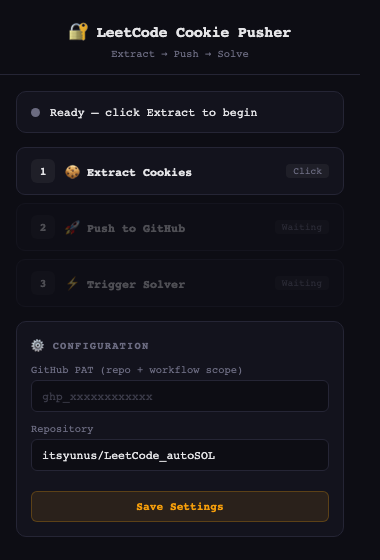

# 🔐 LeetCode Cookie Pusher — Chrome Extension

> **Zero-Friction GitHub Secret Synchronization for Automated LeetCode Solvers.**  
> Extract authenticated cookies, encrypt with Libsodium Sealed Boxes, and push directly to GitHub Actions repository secrets in one click.

---

## 📸 Interface Preview

---

## ⚡ Daily Automation vs. Manual Refresh: How It Works

### ❓ *"Do I need to run this extension every day?"*
**No! You do NOT need to do this daily.**

- **Your GitHub Actions Workflow runs 100% automatically every single day** at `00:30 UTC` via its cron schedule (`30 0 * * *`).
- As long as the `LEETCODE_SESSION` cookie in your secrets is active, the daily solver will execute, fetch walkccc's solution database, validate tests, and commit streak entries without any manual intervention.
- **LeetCode session cookies typically stay valid for 14 to 30 days** (as long as you do not explicitly log out of LeetCode in your browser).
- **When do you use this extension?**  
  Only **once every few weeks** when your LeetCode session rotates, or whenever a GitHub Action run fails with `User is not authenticated (403)`. When that happens, simply open the extension, click **Extract Cookies**, click **Push to GitHub**, and you're good for another month.

---

## 🚀 Quick Setup & Installation

### Step 1: Load Extension into Chrome
1. Open Google Chrome and navigate to `chrome://extensions/`
2. Toggle on **Developer mode** in the top-right corner.
3. Click the **Load unpacked** button in the top-left corner.
4. Select the `leetcode-cookie-ext` folder (located on your Desktop).
5. Pin **LeetCode Cookie Pusher** to your Chrome toolbar.

### Step 2: One-Time Configuration
1. Click the extension icon in your toolbar.
2. In the **Configuration** section:
   - **GitHub PAT**: Paste your GitHub Personal Access Token (requires `repo` and `workflow` scopes).
   - **Repository**: Confirm your target repo (default: `itsyunus/LeetCode_autoSOL`).
3. Click **Save Settings**.

---

## 🛠️ Usage Workflow (3-Click Refresh)

Whenever your LeetCode session expires:
1. Ensure you are signed in on [leetcode.com](https://leetcode.com).
2. Click **1. 🍪 Extract Cookies**: The extension reads `LEETCODE_SESSION` and `csrftoken` from Chrome's cookie storage and verifies your session status against LeetCode's GraphQL API.
3. Click **2. 🚀 Push to GitHub**: Encrypts the tokens client-side using Libsodium Curve25519 sealed boxes and commits them to your repository's Actions Secrets.
4. Click **3. ⚡ Trigger Solver** (Optional): Immediately fires a workflow dispatch run on GitHub Actions to solve today's challenge.

---

## 🔒 Security Architecture

- **No Third-Party Servers**: All operations occur locally in your browser and connect directly to `api.github.com` and `leetcode.com`.
- **Client-Side Libsodium Sealed Box**: Secrets are encrypted in the browser using the repository's public key via X25519 + Blake2b + XSalsa20-Poly1305 before transmission over HTTPS.
- **Chrome Storage Local**: Your GitHub PAT is saved strictly in Chrome's sandboxed local storage.
